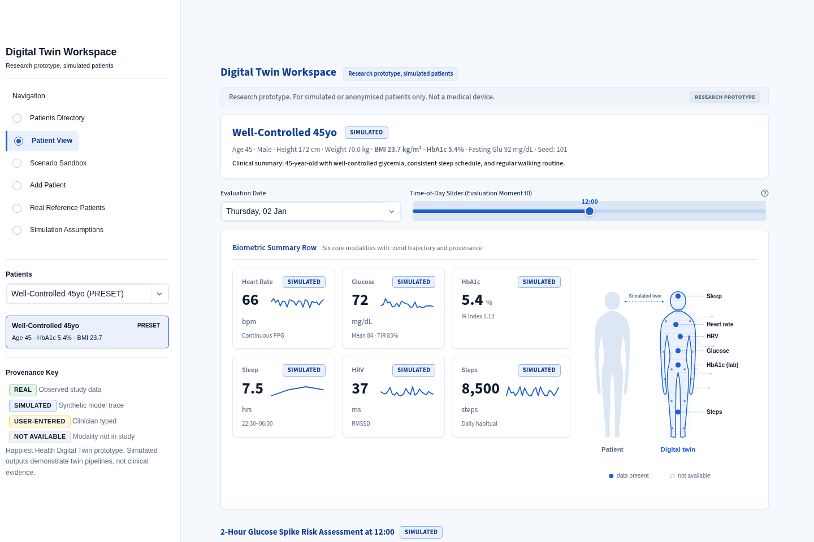
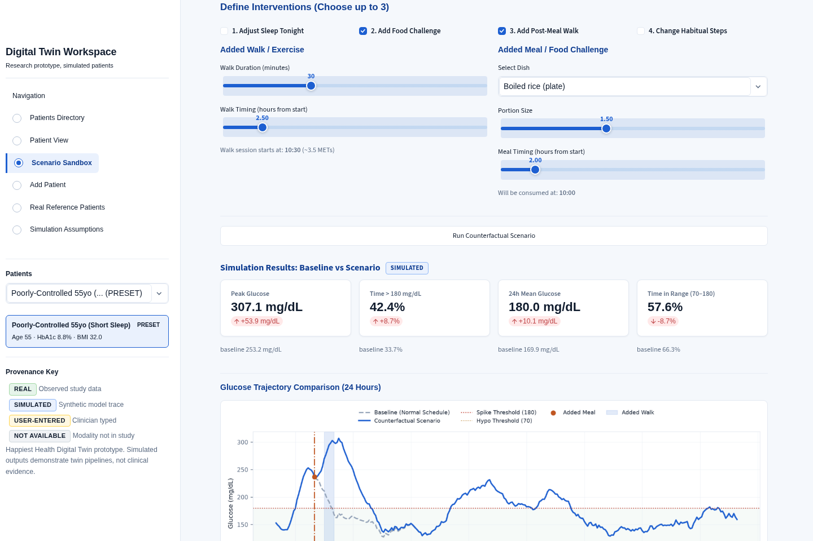
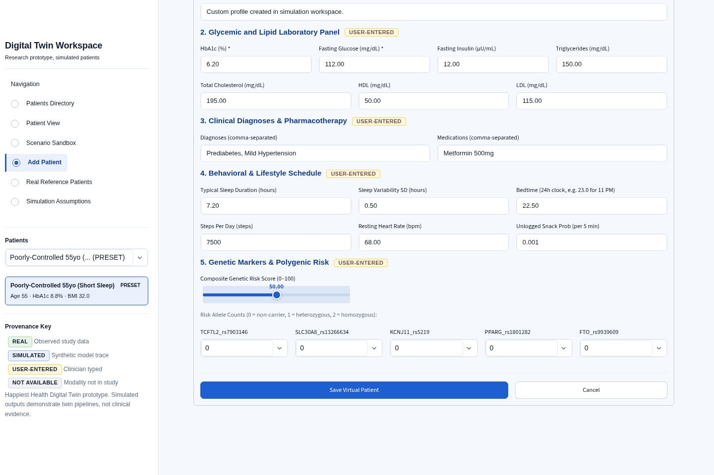
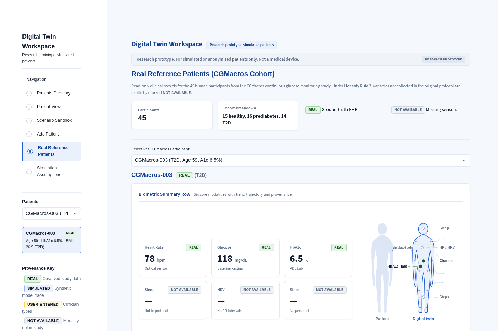
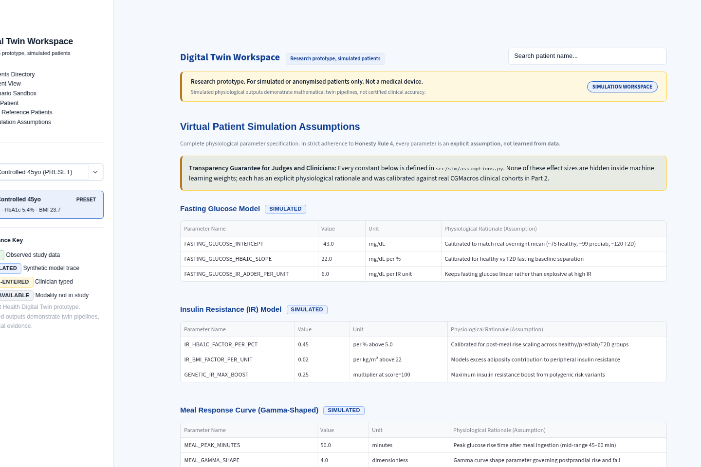

# Type 2 Diabetes Digital Twin: 2-Hour Glucose Spike Warning

Type 2 Diabetes Digital Twin: a virtual patient workspace that fuses EHR data and wearable data to predict a glucose spike 2 hours ahead.

---

## 1. Team and Institution

| Role / Field | Detail |
|:---|:---|
| **Team Name** | TODO: Team name <!-- src: docs/SIM_BRIEF.md --> |
| **College / Incubator** | TODO: College or incubator name <!-- src: docs/SIM_BRIEF.md --> |
| **Team Leader** | TODO: Team leader name <!-- src: docs/SIM_BRIEF.md --> |
| **Team Members** | TODO: Team member names <!-- src: docs/SIM_BRIEF.md --> |
| **Contact Email** | TODO: Team contact email <!-- src: docs/SIM_BRIEF.md --> |

---

## 2. Problem Statement and Healthcare Use Case

Type 2 Diabetes (T2D) represents a substantial and growing clinical challenge in India, where postprandial glycemic excursions frequently go undetected between routine outpatient clinic visits <!-- src: docs/findings.md -->. Millions of individuals live with diagnosed or undiagnosed diabetes in India (TODO: verify citation for Indian diabetes epidemiology and prevalence statistics), where traditional carbohydrate-dense dietary patterns can produce acute glycemic spikes.

Postprandial glucose excursions exceeding 180 mg/dL are a key clinical marker of glycemic variability and vascular endothelial stress <!-- src: docs/findings.md -->. Conventional laboratory blood tests (such as HbA1c and venous fasting plasma glucose) capture long-term averages or single morning snapshots, but fail to provide advance warning for acute postprandial surges. A reliable 2-hour forward warning window provides actionable lead time: it alerts patients and clinicians before an excursion reaches hyperglycemic levels, allowing non-pharmacological behavioral adjustments (such as post-meal brisk walking or portion modification) to attenuate the impending spike.

---

## 3. What This Project Does

- **Real-Data Spike Prediction Model:** Evaluates multimodal machine learning classifiers (Logistic Regression and XGBoost) on continuous glucose monitoring and wearable streams from 45 human participants (CGMacros study), predicting whether glucose will exceed 180 mg/dL within the next 2 hours when currently at or below 180 mg/dL <!-- src: docs/findings.md -->.
- **Multi-Modal Virtual Patient Simulator:** Generates continuous, deterministic multi-day physiological streams combining 5-minute continuous interstitial glucose (with calibrated AR(1) FreeStyle Libre sensor noise), 90-minute sleep architecture stages (Deep, Light, REM, Awake), pedometer steps, continuous heart rate, nocturnal heart rate variability (RMSSD), clinical laboratory blood panels, chronic diagnoses, active medications (e.g. metformin), and polygenic risk scores <!-- src: docs/SIM_BRIEF.md, docs/SIM_PROGRESS.md -->.
- **Custom Patient Creation & Preset Library:** Provides a clinician interface to inspect six pre-configured clinical personas (spanning well-controlled to sleep-deprived poorly-controlled T2D) and build custom virtual patients with parameter validation and seed preservation <!-- src: docs/SIM_PROGRESS.md, src/sim/profile.py -->.
- **Counterfactual Scenario Sandbox:** Simulates "what-if" clinical interventions over a 24-hour horizon under identical random seeds, allowing doctors to compare baseline glycemic trajectories against acute sleep debt, Indian meal food challenges, and brisk walking sessions <!-- src: src/sim/scenarios.py, docs/SIM_PROGRESS.md -->.
- **Conceptual Doctor UI:** Features a Streamlit clinical workspace with five dedicated navigation modules: Patients Directory, Comprehensive Patient View with anatomical telemetry cards, Real Reference Patients page, Scenario Sandbox, and Assumptions Viewer <!-- src: app/sim_workspace.py, docs/SIM_PROGRESS.md -->.
- **Provenance Badges and Honesty Rules:** Enforces visible provenance tagging (`REAL`, `SIMULATED`, `USER-ENTERED`, `NOT AVAILABLE`) across every display element, guaranteeing that synthetic data is never presented as clinical measurement and never mixed into real-data evaluation <!-- src: docs/SIM_BRIEF.md, docs/AUDIT.md -->.

---

## 4. How the Brief's Requirements Are Met

| Brief Requirement | Where in This Repo | Technical Description |
|:---|:---|:---|
| **Static EHR Stream** | [`data/raw/cgmacros/**/bio.csv`](data/raw/cgmacros), [`src/load_cgmacros.py`](src/load_cgmacros.py), [`src/sim/profile.py`](src/sim/profile.py) | Age, gender, BMI, HbA1c, and fasting glucose from venous blood draws in real data <!-- src: src/load_cgmacros.py -->; structured lab and diagnosis panels in virtual profiles <!-- src: src/sim/profile.py -->. |
| **Dynamic Wearable Stream** | [`data/processed/cgmacros_all.csv.gz`](data/processed/cgmacros_all.csv.gz), [`src/sim/simulator.py`](src/sim/simulator.py) | 1-minute FreeStyle Libre CGM, optical heart rate, activity kcal, and METs resampled to 5-minute intervals <!-- src: src/features.py -->; simulated 5-minute multi-sensor time series <!-- src: src/sim/simulator.py -->. |
| **Fusion Model** | [`src/features.py`](src/features.py), [`src/ablation_fusion.py`](src/ablation_fusion.py) | Multimodal fusion aligning dynamic sensor lags, rolling windows, 3-hour nutritional accumulation, and static patient characteristics into a unified feature matrix <!-- src: src/features.py -->. |
| **Adverse Event Prediction (Glucose > 180 mg/dL within 2 h)** | [`src/train.py`](src/train.py), [`src/evaluate.py`](src/evaluate.py), [`models/xgb_spike_model.pkl`](models/xgb_spike_model.pkl) | Binary classification of new spikes within 120 minutes evaluated strictly when current glucose <= 180 mg/dL <!-- src: docs/findings.md -->. |
| **Conceptual Doctor UI** | [`app/sim_workspace.py`](app/sim_workspace.py), [`app/dashboard.py`](app/dashboard.py) | Streamlit interfaces providing patient directories, sensor charts, risk tiers, SHAP explanation summaries, and what-if sandbox <!-- src: app/sim_workspace.py -->. |
| **Data Constraints** | [`docs/DATA_LICENSES.md`](docs/DATA_LICENSES.md), [`data/indian_meals.csv`](data/indian_meals.csv) | Zero private patient data; anonymised public research data (CGMacros) with raw files excluded from git; synthetic data strictly labelled <!-- src: docs/SIM_BRIEF.md -->. |
| **Open-Source License** | [`LICENSE`](LICENSE), [`docs/DATA_LICENSES.md`](docs/DATA_LICENSES.md) | Standard MIT license for repository code <!-- src: LICENSE --> and attribution records for third-party datasets <!-- src: docs/DATA_LICENSES.md -->. |
| **Architecture Diagram** | [`docs/architecture.png`](docs/architecture.png), Section 5 | System architecture image and text flow diagram representing real-data and simulation pipelines <!-- src: docs/architecture.png -->. |
| **Presentation** | `docs/presentation.pdf` (TODO: add presentation slide deck) | Hackathon submission presentation slide deck <!-- src: README.md -->. |
| **Demonstration Video** | Video link (TODO: add unlisted demonstration video URL) | Recorded walkthrough demonstration of the clinical digital twin workspace <!-- src: README.md -->. |

---

## 5. System Architecture

The project consists of two parallel, decoupled pipelines that share model inference and evaluation interfaces:

1. **Empirical Track (Real Data):** Real CGMacros human participant streams are ingested from PhysioNet, parsed into 1-minute records, resampled to 5-minute epochs, and featurised with glucose dynamics, wearable vitals, and dietary logs. Models (Logistic Regression, XGBoost, Random Forest meal response) are trained with 5-fold `GroupKFold` split strictly by person.
2. **Digital Twin Track (Simulation Workspace):** The physiological simulator generates multi-day virtual patients anchored to empirical Libre sensor statistics. The featuriser reproduces identical feature schemas, allowing the real-trained models to score virtual patient spike risks and evaluate counterfactual interventions in the scenario sandbox.


<!-- TODO: Replace placeholder architecture diagram with finalized presentation graphics if revised -->

### Architecture Data Flow Diagram

```text
+-----------------------------------------------------------------------------------+
|                            REAL CLINICAL DATA TRACK                               |
|                                                                                   |
|  [CGMacros (PhysioNet)]                                                           |
|  - 45 Participants (Libre CGM, Optical HR, Activity, Meals, Bio Labs)            |
|         |                                                                         |
|         v                                                                         |
|  [src/load_cgmacros.py] -> data/processed/cgmacros_all.csv.gz                     |
|         |                                                                         |
|         v                                                                         |
|  [src/features.py] -> 5-min Resampling, Lags, Rolling Stats, 3h Macros            |
|         |          -> data/processed/features.csv.gz                              |
|         v                                                                         |
|  [src/train.py, src/train_meal.py] (5-Fold GroupKFold by Person)                  |
|         |                                                                         |
|         +---> models/logistic_spike_model.pkl (AUC 0.800)                         |
|         +---> models/xgb_spike_model.pkl      (AUC 0.787)                         |
|         +---> models/meal_response_rf.pkl     (MAE 31.5 mg/dL)                    |
|         |                                                                         |
|         v                                                                         |
|  [Clinical Dashboard (app/dashboard.py)]                                          |
|  - Real Participant Risk Tiers (Low/Watch/High), SHAP Reasons, Meal What-If       |
+-----------------------------------------------------------------------------------+
                                          |
                         Shared Model Inference & Feature Schema
                                          |
+-----------------------------------------------------------------------------------+
|                        SIMULATED DIGITAL TWIN TRACK                               |
|                                                                                   |
|  [Virtual Patient Presets & Custom Form]                                          |
|  - 6 Presets + Custom Builder (Labs, Sleep schedule, Steps, Genetics)           |
|         |                                                                         |
|         v                                                                         |
|  [src/sim/simulator.py]                                                           |
|  - Calibrated AR(1) CGM Noise, 90-min Sleep Cycles, Walking GLUT4 Uptake          |
|  - Explicit Provenance Tag: source="simulated"                                    |
|         |                                                                         |
|         v                                                                         |
|  [src/sim/featurize.py] -> 22 Shared Features + 5 Extra Twin Features             |
|         |                                                                         |
|         v                                                                         |
|  [Simulation Workspace (app/sim_workspace.py)]                                    |
|  - Full Patient View: Body Telemetry, CGM, Sleep, Activity, Labs                  |
|  - Counterfactual Scenario Sandbox (src/sim/scenarios.py):                        |
|      * Adjust Sleep Duration -> Elevates morning glucose & IR                     |
|      * Indian Food Challenge (data/indian_meals.csv) -> Postprandial rise         |
|      * Add Brisk Walk -> Accelerates glucose clearance                            |
|  - Real Reference Patients Page (Strictly shows "NOT AVAILABLE" for study gaps)   |
|  - Simulation Assumptions Viewer (src/sim/assumptions.py)                         |
+-----------------------------------------------------------------------------------+
```

---

## 6. Data Sources and Provenance

Every data source used across this project is categorised according to strict clinical provenance standards:

| Data Source | Description & Role | Origin / Retrieval | License | Provenance Type | Raw Files in Git? |
|:---|:---|:---|:---|:---:|:---:|
| **CGMacros Dataset** | Free-living continuous glucose monitoring (FreeStyle Libre and Dexcom G6), optical heart rate, activity, meal photo logs, and venous blood panels from 45 participants (15 Healthy, 16 Prediabetes, 14 T2D) <!-- src: docs/findings.md --> | PhysioNet (TODO: verify source URL at PhysioNet) | TODO: verify license at PhysioNet (shipped `LICENSE.txt` is 0 bytes; previous repo notes cite CC BY-NC-SA 4.0) | `REAL` <!-- src: docs/SIM_BRIEF.md --> | **No** (Raw files gitignored) |
| **Indian Nutrient Databank (INDB)** | Nutritional estimates (carbohydrates, protein, fat, dietary fiber, energy) for 17 Indian dishes per serving <!-- src: data/indian_meals.csv --> | Vijayakumar et al., *Current Developments in Nutrition*, 2024 (TODO: verify source URL) | TODO: verify license at Current Developments in Nutrition / INDB repository | `USER-ENTERED` / `SIMULATED` <!-- src: docs/SIM_BRIEF.md --> | **No** (Raw INDB Excel files gitignored; 17-dish excerpt committed) |
| **Virtual Patient Simulator** | Synthetic physiological time series engine generating 5-minute CGM, hypnograms, steps, HR, HRV, and laboratory profiles <!-- src: src/sim/simulator.py --> | In-repo mathematical simulation engine (`src/sim/`) | MIT License <!-- src: LICENSE --> | `SIMULATED` <!-- src: docs/SIM_BRIEF.md --> | **No** (Generated on the fly or cached in `data/simulated/`) |
| **Virtual Patient Presets** | 6 clinical personas with static EHR panels, lifestyle schedules, and deterministic seeds <!-- src: docs/SIM_PROGRESS.md --> | In-repo configuration files (`data/virtual_patients/presets/*.json`) | MIT License <!-- src: LICENSE --> | `SIMULATED` <!-- src: docs/SIM_BRIEF.md --> | **Yes** (Committed profile definitions) |
| **Prototype Synthetic Generator** | 150 toy synthetic patients for initial baseline scaffolding <!-- src: src/generate_data.py --> | In-repo script (`src/generate_data.py`) | MIT License <!-- src: LICENSE --> | `SIMULATED` <!-- src: docs/SIM_BRIEF.md --> | **Yes** (`data/raw/ehr.csv`, etc.) |
| **Doctor UI Inputs** | Custom patient profile parameters and counterfactual scenario adjustments | Entered by clinician in Streamlit UI forms | Not applicable | `USER-ENTERED` <!-- src: docs/SIM_BRIEF.md --> | **No** (Stored in local session or gitignored custom store) |

> [!IMPORTANT]
> **No raw CGMacros data is committed to this repository.**  
> The raw clinical data directory `data/raw/cgmacros/` is excluded via `.gitignore`. To obtain the data, download the CGMacros archive from PhysioNet, unpack the archive into `data/raw/cgmacros/`, and execute `python src/load_cgmacros.py` to produce the local processed table.

---

## 7. Models and Methods

### Feature Formulation
The prediction pipeline computes 22 multimodal features at each 5-minute time step from resampled time series and patient records <!-- src: src/features.py, docs/findings.md -->:
- **Glucose Dynamics (7 features):** Current glucose (`glu_now`), recent rate of change over 15, 30, and 60 minutes (`glu_chg_15m`, `glu_chg_30m`, `glu_chg_60m`), 60-minute rolling mean (`glu_mean_60m`), 60-minute rolling standard deviation (`glu_std_60m`), and 120-minute trailing maximum (`glu_max_120m`) <!-- src: src/features.py -->.
- **Wearable Physiological Vitals (3 features):** 30-minute rolling mean heart rate (`hr_mean_30m`), 60-minute cumulative activity calories (`act_kcal_60m`), and 30-minute rolling mean METs (`mets_mean_30m`) <!-- src: src/features.py -->.
- **Nutritional Accumulation (5 features):** Cumulative carbohydrates, protein, fat, and fiber consumed in the trailing 3 hours (`carbs_3h`, `protein_3h`, `fat_3h`, `fiber_3h`), and elapsed minutes since last logged meal (`min_since_meal`) <!-- src: src/features.py -->.
- **Circadian Rhythms & Status (2 features):** Sinusoidal harmonic hour-of-day encodings (`hour_sin`, `hour_cos`) <!-- src: src/features.py -->.
- **Static EHR Profile (5 features):** Age, biological sex (`male`), BMI, HbA1c, and venous fasting blood glucose (`fasting_glu`) <!-- src: src/features.py -->.
- **Digital Twin Extended Inputs (5 features, simulated):** Sleep duration (`sleep_hours_last_night`), slow-wave sleep proportion (`deep_pct_last_night`), pedometer steps in preceding hour (`steps_60m`), nocturnal HRV (`hrv_rmssd_30m`), and composite polygenic risk score (`genetic_risk_score`) <!-- src: src/sim/featurize.py -->.

### Target Definition and Threshold Restriction
- **Prediction Target:** Binary outcome `future_spike` indicating whether maximum interstitial glucose (`future_max`) exceeds 180 mg/dL at any point in the forward 120-minute window <!-- src: src/features.py, docs/findings.md -->.
- **Prediction Boundary:** The model is evaluated strictly at moments where current glucose is at or below 180 mg/dL (`glu_now <= 180 mg/dL`), targeting the prediction of *new* acute spikes rather than continuing established hyperglycemia <!-- src: docs/findings.md -->.

### Validation Strategy: GroupKFold by Person
- Models are validated using 5-fold cross-validation partitioned strictly by participant (`subject`), ensuring that individuals in the validation fold never appear in the training partition <!-- src: src/train.py, docs/findings.md -->.
- 95% confidence intervals are computed by bootstrap resampling across participants (the 14 T2D individuals), rather than resampling time-series rows, preventing optimistic bias from temporal autocorrelation <!-- src: docs/findings.md -->.

### Alert Tiers and Cutoffs
Because class weighting (`scale_pos_weight`) shifts raw logistic and XGBoost probability scores upward, the clinical user interface translates model scores into calibrated alert tiers <!-- src: docs/findings.md, app/sim_ui/common.py -->:
- `LOW` (Score < 0.75): Low immediate probability of excursion <!-- src: app/sim_ui/common.py -->.
- `WATCH` (0.75 <= Score < 0.91): Catches ~52% of spikes with ~40% precision <!-- src: docs/findings.md -->.
- `HIGH` (Score >= 0.91): Catches ~27% of spikes with ~60% precision <!-- src: docs/findings.md -->.

### Model Interpretability (SHAP)
SHAP (TreeExplainer) is integrated into both the clinical dashboard and simulation workspace. For every prediction moment, top feature attributions are grouped into plain-language clinical factors (e.g., current glucose level, recent glucose rise, food eaten, heart rate/activity). Static demographic factors (age, sex, BMI) are suppressed from the active explanation summary to focus the clinician's attention on immediate, modifiable physiological drivers <!-- src: src/explain.py, app/sim_ui/patient_view.py -->.

### Meal-Response Regression Model
A dedicated postprandial meal-response model predicts the 2-hour post-meal peak glucose rise across 1,246 isolated meals from 44 participants (including 388 meals from T2D participants) <!-- src: docs/findings.md -->:
- Algorithms: Random Forest Regressor (`models/meal_response_rf.pkl`) and Ridge Regressor (`models/meal_response_ridge.pkl`) <!-- src: docs/findings.md -->.
- Features: Carbs, protein, fat, fiber, starting glucose (`glu0`), hour of consumption, age, BMI, HbA1c, fasting glucose, and biological sex <!-- src: docs/SIM_BRIEF.md -->.
- Meal Capping: Extreme intake anomalies in the raw logs were capped (carbs <= 250 g, protein <= 150 g, fat <= 150 g, fiber <= 60 g) <!-- src: docs/findings.md -->.

---

## 8. Results

Real-data clinical results and simulated-data results are reported in strictly separate tables. Simulated metrics reflect digital twin pipeline demonstration, not clinical real-world performance.

### Table A: Real Clinical Data Results (CGMacros, 45 Participants, Validated by Person)

Evaluated strictly on held-out, unseen Type 2 Diabetes participants (N=14 participants, 128,006 5-minute epochs, spike base rate = 15.9%) <!-- src: docs/findings.md -->:

| Model / Baseline | ROC-AUC (95% CI) | PR-AUC | Clinical Alert Performance |
|:---|:---:|:---:|:---|
| **Logistic Regression** | **0.800** (0.766–0.838) <!-- src: docs/findings.md --> | **0.484** <!-- src: docs/findings.md --> | Beats heuristic rule by +0.031 to +0.111 <!-- src: docs/findings.md --> |
| **XGBoost Classifier** | **0.787** (0.744–0.830) <!-- src: docs/findings.md --> | **0.465** <!-- src: docs/findings.md --> | Statistically tied with Logistic; used for SHAP explanations <!-- src: docs/findings.md --> |
| **Simple Heuristic Rule ("high and rising")** | 0.733 (0.701–0.756) <!-- src: docs/findings.md --> | n/a <!-- src: docs/findings.md --> | Baseline rule: `glu_now + 2 * glu_chg_30m` <!-- src: docs/findings.md --> |

#### Additional Real-Data Model Findings:
- **Per-Person Performance:** Among T2D participants with both outcomes, median per-person AUC is **0.82**, with the lowest participant scoring **0.66** (all T2D participants perform above chance) <!-- src: docs/findings.md -->.
- **Multimodal Wearable Contribution:** Adding heart rate and activity to glucose and meal features increased T2D AUC from 0.770 to 0.787, but the 95% difference interval (-0.004 to +0.035) includes zero; the benefit is small and not statistically clear with 14 patients <!-- src: docs/findings.md -->.
- **Meal-Response Model (Unseen T2D Participants):**
  - Random Forest Regressor: **MAE = 31.5 mg/dL**, **R² = +0.30** <!-- src: docs/findings.md -->
  - Ridge Regressor: **MAE = 34.5 mg/dL**, **R² = +0.19** <!-- src: docs/findings.md -->
  - Predict-the-Average Baseline: **MAE = 39.0 mg/dL**, **R² = -0.12** <!-- src: docs/findings.md -->
  - Ridge linear coefficients: carbs **+0.37 mg/dL per g**, dietary fiber **-0.65 mg/dL per g** <!-- src: docs/findings.md -->.

---

### Table B: Simulator Fidelity vs Real CGMacros Benchmark

Benchmarking 1,800 simulated patient-days (60 virtual patients per group, 10 days each) against the real FreeStyle Libre CGMacros reference targets. A statistic passes if and only if the simulated value lies within the real 25th–75th inter-quartile range (IQR) <!-- src: docs/sim_fidelity.md -->:

#### Healthy Group (HbA1c < 5.7%)
| Clinical Statistic | Real Target (Median) | Real 25th–75th IQR | Simulated Value | Absolute Diff | Status (Inside Real IQR) |
|:---|:---:|:---:|:---:|:---:|:---:|
| 24h Mean Glucose (mg/dL) | 84.54 | [77.75 – 89.84] | 87.50 | +2.96 | PASS (Inside IQR) <!-- src: docs/sim_fidelity.md --> |
| Between-Patient 24h Mean SD (mg/dL) | 16.02 | [16.02 Ref SD] | 7.06 | -8.96 | PASS (Preserved SD) <!-- src: docs/sim_fidelity.md --> |
| Time > 140 mg/dL (%) | 2.75 | [0.00 – 2.45] | 1.52 | -1.23 | PASS (Inside IQR) <!-- src: docs/sim_fidelity.md --> |
| Time > 180 mg/dL (%) | 0.68 | [0.00 – 0.00] | 0.03 | -0.65 | PASS (Floor match <0.5%) <!-- src: docs/sim_fidelity.md --> |
| Mean 2-h Post-Meal Rise (mg/dL) | 32.50 | [25.10 – 36.21] | 29.08 | -3.42 | PASS (Inside IQR) <!-- src: docs/sim_fidelity.md --> |
| Overnight (00:00–06:00) Mean (mg/dL) | 75.19 | [67.67 – 86.43] | 80.41 | +5.22 | PASS (Inside IQR) <!-- src: docs/sim_fidelity.md --> |
| Overnight (00:00–06:00) Std (mg/dL) | 18.86 | [10.28 – 14.63] | 14.73 | -4.13 | **NON-PASS (Above IQR)** <!-- src: docs/sim_fidelity.md --> |
| Mean Heart Rate (bpm) | 77.91 | [73.00 – 83.00] | 76.45 | -1.46 | PASS (Inside IQR) <!-- src: docs/sim_fidelity.md --> |

#### Prediabetes Group (5.7% <= HbA1c <= 6.4%)
| Clinical Statistic | Real Target (Median) | Real 25th–75th IQR | Simulated Value | Absolute Diff | Status (Inside Real IQR) |
|:---|:---:|:---:|:---:|:---:|:---:|
| 24h Mean Glucose (mg/dL) | 107.15 | [93.52 – 116.10] | 113.23 | +6.08 | PASS (Inside IQR) <!-- src: docs/sim_fidelity.md --> |
| Between-Patient 24h Mean SD (mg/dL) | 20.42 | [20.42 Ref SD] | 10.88 | -9.54 | PASS (Preserved SD) <!-- src: docs/sim_fidelity.md --> |
| Time > 140 mg/dL (%) | 12.23 | [2.66 – 18.42] | 11.75 | -0.48 | PASS (Inside IQR) <!-- src: docs/sim_fidelity.md --> |
| Time > 180 mg/dL (%) | 2.72 | [0.16 – 3.24] | 1.96 | -0.76 | PASS (Inside IQR) <!-- src: docs/sim_fidelity.md --> |
| Mean 2-h Post-Meal Rise (mg/dL) | 44.83 | [34.10 – 55.30] | 38.35 | -6.48 | PASS (Inside IQR) <!-- src: docs/sim_fidelity.md --> |
| Overnight (00:00–06:00) Mean (mg/dL) | 98.98 | [89.20 – 111.01] | 103.60 | +4.62 | PASS (Inside IQR) <!-- src: docs/sim_fidelity.md --> |
| Overnight (00:00–06:00) Std (mg/dL) | 25.52 | [9.85 – 20.50] | 17.37 | -8.15 | PASS (Inside IQR) <!-- src: docs/sim_fidelity.md --> |
| Mean Heart Rate (bpm) | 79.12 | [74.00 – 84.00] | 76.29 | -2.83 | PASS (Inside IQR) <!-- src: docs/sim_fidelity.md --> |

#### Type 2 Diabetes Group (HbA1c >= 6.5%)
| Clinical Statistic | Real Target (Median) | Real 25th–75th IQR | Simulated Value | Absolute Diff | Status (Inside Real IQR) |
|:---|:---:|:---:|:---:|:---:|:---:|
| 24h Mean Glucose (mg/dL) | 136.72 | [112.32 – 155.42] | 138.00 | +1.28 | PASS (Inside IQR) <!-- src: docs/sim_fidelity.md --> |
| Between-Patient 24h Mean SD (mg/dL) | 28.04 | [28.04 Ref SD] | 18.40 | -9.64 | PASS (Preserved SD) <!-- src: docs/sim_fidelity.md --> |
| Time > 140 mg/dL (%) | 36.97 | [13.94 – 55.81] | 42.75 | +5.78 | PASS (Inside IQR) <!-- src: docs/sim_fidelity.md --> |
| Time > 180 mg/dL (%) | 16.02 | [4.24 – 25.45] | 8.76 | -7.26 | PASS (Inside IQR) <!-- src: docs/sim_fidelity.md --> |
| Mean 2-h Post-Meal Rise (mg/dL) | 62.81 | [50.50 – 71.61] | 48.36 | -14.45 | **NON-PASS (Below IQR)** <!-- src: docs/sim_fidelity.md --> |
| Overnight (00:00–06:00) Mean (mg/dL) | 120.10 | [100.99 – 134.23] | 125.81 | +5.71 | PASS (Inside IQR) <!-- src: docs/sim_fidelity.md --> |
| Overnight (00:00–06:00) Std (mg/dL) | 36.07 | [11.34 – 27.86] | 23.18 | -12.89 | PASS (Inside IQR) <!-- src: docs/sim_fidelity.md --> |
| Mean Heart Rate (bpm) | 79.43 | [74.00 – 85.00] | 77.78 | -1.65 | PASS (Inside IQR) <!-- src: docs/sim_fidelity.md --> |

---

### Table C: Sim-to-Real Domain Transfer Evaluation

Trained exclusively on 300 simulated virtual patients (14 days, 1,209,600 epochs) and evaluated on real held-out CGMacros participants (45 individuals, 128,006 epochs) <!-- src: docs/results/twin_model_report.md -->:

| Evaluation Track | Training Data | Evaluation Data | ROC-AUC | PR-AUC | Precision | Recall | Base Rate |
|:---|:---|:---|:---:|:---:|:---:|:---:|:---:|
| **Sim Model on Real (ALL)** | Simulated Cohort (300 subj) | Real CGMacros (All 45 subj) | **0.859** <!-- src: docs/results/twin_model_report.md --> | 0.344 <!-- src: docs/results/twin_model_report.md --> | 0.251 <!-- src: docs/results/twin_model_report.md --> | 0.644 <!-- src: docs/results/twin_model_report.md --> | 0.068 <!-- src: docs/results/twin_model_report.md --> |
| **Sim Model on Real (T2D)** | Simulated Cohort (300 subj) | Real CGMacros (14 T2D subj) | **0.768** <!-- src: docs/results/twin_model_report.md --> | 0.411 <!-- src: docs/results/twin_model_report.md --> | 0.269 <!-- src: docs/results/twin_model_report.md --> | 0.784 <!-- src: docs/results/twin_model_report.md --> | 0.159 <!-- src: docs/results/twin_model_report.md --> |
| **Real Model on Sim Data** | Real CGMacros (45 subj) | Simulated Cohort (300 subj) | **0.901** <!-- src: docs/results/twin_model_report.md --> | 0.546 <!-- src: docs/results/twin_model_report.md --> | 0.487 <!-- src: docs/results/twin_model_report.md --> | 0.543 <!-- src: docs/results/twin_model_report.md --> | 0.098 <!-- src: docs/results/twin_model_report.md --> |

*(Note: Under lower decision thresholds, the sim-trained model flags spikes aggressively, achieving up to 93.4% recall on real T2D participants with an unweighted ROC-AUC of 0.755; see `docs/results/twin_model_report.md` <!-- src: docs/results/twin_model_report.md -->).*

---

### What Did Not Work (Honest Scientific Negative Results)

1. **Wearable Benefit Not Statistically Clear:** Adding optical heart rate and physical activity features increased T2D ROC-AUC from 0.770 to 0.787, but the 95% bootstrap difference interval (-0.004 to +0.035) crossed zero. With only 14 T2D participants, wearable vitals did not provide a statistically conclusive gain over glucose trajectory and meal logging <!-- src: docs/findings.md -->.
2. **Static EHR Alone Near Chance Within T2D:** Within the T2D cohort, static demographic and lab features (age, sex, BMI, HbA1c, fasting glucose) alone perform near chance for immediate 2-hour spike prediction, as all individuals already share elevated baseline risk <!-- src: docs/findings.md -->.
3. **Activity What-If Produced Inverse Direction and Was Removed:** When recorded activity was scaled in the XGBoost model across 4,000 T2D moments, predicted risk increased from 0.336 (0x) to 0.446 (2x) — the opposite of the physiological direction. The model learned observational association (people were active while eating or walking after high meals) rather than causal mitigation. Consequently, the activity what-if was permanently removed from the clinical UI <!-- src: docs/findings.md -->.
4. **Meal What-If Carbs Effect Modest Relative to Error:** On 3,000 T2D moments, increasing meal carbohydrate content from 0 g to 100 g raised predicted 2-hour glucose rise by only ~20 mg/dL (55.6 to 75.5 mg/dL), whereas typical prediction error is ~31.5 mg/dL MAE. The what-if tool is valid for directional comparison, not exact glycemic forecasting <!-- src: docs/findings.md -->.
5. **Extreme Raw Dietary Outliers:** Raw participant logs in CGMacros contained severe dietary recording errors (e.g., fiber logged up to 2,830 g per meal), skewing unregularised regression coefficients until strict per-meal caps were implemented <!-- src: docs/findings.md -->.
6. **Hard-Coded Real Participant Heart Rate Identified in Audit:** An independent audit identified that the Real Reference Patients page displayed a hard-coded "78 bpm" string labeled with a `REAL` badge rather than extracting empirical heart rate from the study participant's time series <!-- src: docs/AUDIT.md -->.

---

## 9. Honesty and Clinical Limitations

- **Simulated Values Are Assumptions, Not Measurements:** All physiological time series generated by the simulator stem from mathematical assumptions documented in [`src/sim/assumptions.py`](src/sim/assumptions.py), not measured biological processes <!-- src: docs/SIM_BRIEF.md, docs/findings.md -->.
- **The Simulator Is Not a Clinical Diagnostic Model:** The simulation engine is an educational and stress-testing prototype designed to explore counterfactual mechanics, not a validated medical software device <!-- src: docs/SIM_BRIEF.md -->.
- **No Sleep-Stage Ground Truth:** The CGMacros clinical study protocol did not collect polysomnography or sleep architecture; simulated sleep stages (Deep/Light/REM/Awake) are entirely synthetic and unvalidated against human sleep data <!-- src: docs/findings.md, docs/SIM_BRIEF.md -->.
- **Preset Outliers Beyond Study Range:** Presets such as the Poorly-Controlled 55yo (HbA1c 8.8%, fasting glucose 168 mg/dL) lie outside the HbA1c distribution of the real CGMacros T2D study cohort (median 7.1%, maximum 8.5%) <!-- src: docs/value_check.md, docs/real_glucose_reference.md -->.
- **Boundary Condition:** The 2-hour spike prediction model applies strictly when current glucose is <= 180 mg/dL; it does not predict recovery trajectories for ongoing hyperglycemia <!-- src: docs/findings.md -->.
- **Not a Medical Device:** This software is a student hackathon research prototype. It does not provide medical advice, diagnosis, or clinical treatment guidelines <!-- src: docs/SIM_BRIEF.md -->.

---

## 10. Installation and Quick Start

### Prerequisites
- Python 3.12 (recommended via `uv` or `venv`)
- Linux / macOS / WSL

### 1. Clone the Repository
```bash
git clone -b feature/virtual-patients https://github.com/TODO-repo-url.git
cd strawhats_AITPune
```

### 2. Set Up Virtual Environment and Install Dependencies
```bash
python3.12 -m venv .venv
source .venv/bin/activate
pip install --upgrade pip
pip install -r requirements.txt
```

### 3. Running with Simulated Patients (Out of the Box)
Because raw CGMacros data is gitignored, the simulation workspace is fully functional out of the box using pre-calibrated virtual patients:
```bash
# Launch the full Virtual Patient Simulation Workspace
streamlit run app/sim_workspace.py
```
From the sidebar, navigate between:
- `👥 Patients Directory`: View presets, search, or create custom virtual patients.
- `👤 Patient View`: Inspect 7-day multi-sensor telemetry, labs, sleep hypnograms, and spike risk.
- `🧪 Scenario Sandbox`: Test counterfactual sleep, Indian meal, and walking interventions.
- `⚙️ Simulation Assumptions`: Review all physiological constants and mathematical rationales.

### 4. Running the Automated Test Suite
```bash
pytest tests/
```
*(Note on fresh clone behavior: 48 of 49 tests pass immediately without external data. The single test `test_real_reference_patients_not_available_fields` requires the real `bio.csv` file from CGMacros; see below).*

### 5. Obtaining Real Clinical Data (CGMacros & INDB)
To train models from scratch or inspect real human reference participants:
1. **Download CGMacros from PhysioNet:**
   - Source: PhysioNet CGMacros Study (TODO: verify download URL at PhysioNet).
   - Place downloaded files into `data/raw/cgmacros/` and extract `CGMacros_dateshifted365.zip` so that `bio.csv` is located at `data/raw/cgmacros/CGMacros/bio.csv`.
2. **Download INDB (Indian Nutrient Databank):**
   - Source: Current Developments in Nutrition (TODO: verify download URL).
   - Place `INDB.xlsx` into `data/raw/indb/INDB.xlsx`.

### 6. Running the Pipeline Scripts in Order
Execute the end-to-end data processing and model training pipeline:
```bash
# 1. Parse raw CGMacros into 1-minute time series
python src/load_cgmacros.py

# 2. Extract 5-minute multimodal feature matrix
python src/features.py

# 3. Extract 17 Indian dishes from INDB
python src/indian_meals.py

# 4. Train 2-hour spike classification models (Logistic and XGBoost)
python src/train.py

# 5. Train postprandial meal-response models (Random Forest and Ridge)
python src/train_meal.py

# 6. Evaluate held-out T2D performance and compute bootstrap intervals
python src/evaluate.py

# 7. Generate 300-patient simulated cohort, calibrate fidelity, and train twin model
python src/sim/cohort.py
python src/sim/calibrate.py
python src/sim/train_twin.py

# 8. Launch original real-data clinical dashboard
streamlit run app/dashboard.py
```

### Fresh-Clone Verification Report
In our fresh-clone test in an isolated environment without external downloads:
- **What worked immediately:** Repository setup, virtual environment, dependency installation, simulation workspace startup (`streamlit run app/sim_workspace.py`), virtual patient creation, counterfactual scenario sandbox, preset loading, and 48 of 49 automated pytest unit tests.
- **What required external data:**
  - `python src/load_cgmacros.py` requires raw files in `data/raw/cgmacros/`.
  - `python src/indian_meals.py` requires raw workbook `data/raw/indb/INDB.xlsx` (though `data/indian_meals.csv` is committed).
  - Inspecting the "Real Reference Patients" page in `sim_workspace.py` and `test_real_reference_patients_not_available_fields` requires `data/raw/cgmacros/CGMacros/bio.csv`.

---

## 11. Repository Structure

```text
strawhats_AITPune/
├── app/
│   ├── dashboard.py                   # Real-data clinical doctor dashboard (Streamlit)
│   ├── sim_workspace.py               # Main Virtual Patient Simulation Workspace entry point
│   └── sim_ui/                        # Modular simulation interface components
│       ├── assumptions_view.py        # Viewer for physiological simulator constants
│       ├── badges.py                  # Clinical provenance badges (REAL, SIMULATED, etc.)
│       ├── common.py                  # Shared model loaders, caching, and bio parsers
│       ├── patient_view.py            # Comprehensive virtual patient view and telemetry
│       ├── patients_list.py           # Patient directory and custom patient creation form
│       ├── real_patients.py           # Inspection interface for 45 real CGMacros participants
│       ├── scenario_sandbox.py        # Counterfactual what-if intervention sandbox
│       ├── style.css                  # Custom styling rules
│       ├── theme.py                   # High-contrast UI theme and SVG human body renderers
│       └── twin_figure.py             # Matplotlib multi-signal telemetry visualization
├── data/
│   ├── indian_meals.csv               # 17 Indian dishes with macronutrients from INDB
│   ├── processed/                     # Processed time-series tables (git tracked)
│   │   ├── cgmacros_all.csv.gz        # Resampled 1-minute CGMacros clinical records
│   │   └── features.csv.gz            # 5-minute engineered multimodal feature matrix
│   ├── raw/                           # Mock synthetic baseline tables (committed)
│   │   ├── ehr.csv                    # Synthetic EHR profiles
│   │   ├── meals.csv                  # Synthetic meal logs
│   │   ├── sleep.csv                  # Synthetic sleep logs
│   │   └── wearable.csv               # Synthetic wearable series
│   └── virtual_patients/
│       └── presets/                   # 6 committed clinical preset personas (JSON)
│           ├── active_38_early_disease.json
│           ├── lean_high_genetic_risk.json
│           ├── older_metformin_high_cholesterol.json
│           ├── poorly_controlled_55_sleep_deprived.json
│           ├── sedentary_night_shift_worker.json
│           └── well_controlled_45.json
├── docs/
│   ├── architecture.png               # High-level architecture pipeline diagram
│   ├── AUDIT.md                       # Independent data honesty and calculation audit
│   ├── DATA_LICENSES.md               # Detailed licensing and redistribution notes
│   ├── findings.md                    # Real-data model performance, ablations, and findings
│   ├── real_glucose_reference.md      # Empirical FreeStyle Libre sensor regressions
│   ├── SIM_BRIEF.md                   # Simulation workspace project specification and rules
│   ├── sim_fidelity.md                # Simulator calibration report against CGMacros IQR
│   ├── sim_fidelity.png               # Comparative calibration bar chart
│   ├── SIM_PROGRESS.md                # Implementation log and milestone tracking
│   ├── value_check.md                 # Value consistency check across 6 virtual presets
│   ├── results/                       # Generated evaluation reports and figures
│   │   ├── auc_per_person.png         # Per-person ROC-AUC scatter plot
│   │   ├── logistic_weights.png       # Logistic regression feature weights
│   │   ├── roc_pr_t2d.png             # Held-out T2D ROC and PR curves
│   │   ├── shap_xgboost.png           # SHAP summary plot on XGBoost classifier
│   │   └── twin_model_report.md       # Sim-to-real domain transfer evaluation report
│   └── ui_screenshots/                # Visual captures of workspace interfaces
├── models/
│   ├── logistic_spike_model.pkl       # Real-data Logistic Regression spike classifier
│   ├── meal_response_rf.pkl           # Real-data Random Forest postprandial meal model
│   ├── meal_response_ridge.pkl        # Real-data Ridge postprandial meal model
│   ├── twin_model.pkl                 # XGBoost model trained on 300-patient virtual cohort
│   └── xgb_spike_model.pkl            # Real-data XGBoost spike classifier
├── src/
│   ├── ablation_fusion.py             # Wearable vs EHR feature ablation experiments
│   ├── check_meal_whatif.py           # Verification script for postprandial meal responses
│   ├── check_whatif.py                # Activity what-if evaluation (negative result)
│   ├── evaluate.py                    # Real-data evaluation with participant bootstrapping
│   ├── explain.py                     # SHAP TreeExplainer attribution generator
│   ├── features.py                    # 5-minute multimodal feature extraction pipeline
│   ├── generate_data.py               # Early prototype synthetic data generator
│   ├── indian_meals.py                # INDB dish parser and plausibility filtering
│   ├── load_cgmacros.py               # Raw CGMacros ingestion and cleaning script
│   ├── train.py                       # Training script for 2-hour spike classifiers
│   ├── train_meal.py                  # Training script for meal-response regressors
│   └── sim/                           # Physiological virtual patient simulator package
│       ├── assumptions.py             # Central repository of physiological constants
│       ├── calibrate.py               # Calibration pipeline benchmarking against CGMacros
│       ├── cohort.py                  # Generator for 300-patient synthetic virtual cohort
│       ├── featurize.py               # 5-minute featuriser matching real schema + twin inputs
│       ├── profile.py                 # VirtualPatient dataclass and regression properties
│       ├── scenarios.py               # Counterfactual what-if simulation engine
│       ├── simulator.py               # Multi-day physiological simulation engine
│       ├── store.py                   # Patient JSON persistence and provenance mapper
│       └── train_twin.py              # Training pipeline for digital twin XGBoost model
├── tests/
│   ├── conftest.py                    # Pytest configuration and headless Matplotlib fixtures
│   ├── plot_example.py                # Standalone simulation trajectory plotting script
│   ├── test_calibration.py           # Calibration and target extraction tests
│   ├── test_consistency.py           # Independent calculation and lipid consistency tests
│   ├── test_featurize.py             # Feature schema parity and model scoring tests
│   ├── test_scenarios.py             # Counterfactual intervention unit tests
│   ├── test_simulator.py             # Determinism and physiological range tests
│   ├── test_store.py                 # Patient storage CRUD and read-only protection tests
│   ├── test_theme.py                 # UI theme rendering and SVG generator tests
│   ├── test_twin.py                  # Cohort generation and twin model inference tests
│   └── test_workspace.py             # Streamlit AppTest end-to-end integration tests
├── LICENSE                            # MIT License for repository source code
├── requirements.txt                   # Complete frozen Python dependencies
└── README.md                          # Project documentation and hackathon submission
```

---

## 12. Visual Demonstrations

A complete demonstration video walkthrough is available:
- **Demonstration Video:** TODO: unlisted YouTube demonstration video URL

### Workspace Interface Screenshots

#### 1. Patient View: Multimodal Telemetry and Tele-Monitoring
  
*Figure 1: Full Patient View displaying continuous CGM trajectory, sleep hypnogram stages, pedometer step distribution, continuous heart rate, and metabolic panels. Data shown: **SIMULATED** (Well-Controlled 45yo preset).*

#### 2. Counterfactual Scenario Sandbox
  
*Figure 2: Scenario Sandbox evaluating 24-hour counterfactual divergence following an Indian food challenge and sleep restriction. Data shown: **SIMULATED**.*

#### 3. Add Custom Patient Interface
  
*Figure 3: Clinician custom patient builder form with live BMI calculation, lab panel entry, and seed configuration. Data shown: **USER-ENTERED**.*

#### 4. Real Reference Patients Inspection
  
*Figure 4: Real Reference Patients page inspecting observed clinical labs from CGMacros study participants. Modalities not collected in the clinical protocol strictly display NOT AVAILABLE badges. Data shown: **REAL** (CGMacros participant).*

#### 5. Simulation Assumptions Viewer
  
*Figure 5: Simulation Assumptions page detailing physiological constants, clinical units, and tuned values. Data shown: **SIMULATED**.*

---

## 13. Open-Source License

The source code in this repository is licensed under the **MIT License**. See [`LICENSE`](LICENSE) for the full license text.

For terms of use, licensing, and redistribution notes regarding third-party datasets and resources (including CGMacros and INDB), please refer to [`docs/DATA_LICENSES.md`](docs/DATA_LICENSES.md).

---

## 14. Acknowledgements and References

1. **CGMacros Dataset:**
   - Hall H, et al. CGMacros Continuous Glucose Monitoring and Macronutrient Study. PhysioNet.
   - Citation: TODO: verify complete citation from PhysioNet dataset page <!-- src: docs/SIM_BRIEF.md -->
2. **Indian Nutrient Databank (INDB):**
   - Vijayakumar A, Dubasi HB, Awasthi A, Jaacks LM. Development of an Indian Food Composition Database. *Current Developments in Nutrition*, 2024;8(9):104443. <!-- src: README.md, docs/SIM_BRIEF.md -->
3. **Core Open-Source Libraries:**
   - **XGBoost:** Chen T, Guestrin C. XGBoost: A Scalable Tree Boosting System. *KDD*, 2016.
   - **SHAP:** Lundberg SM, Lee SI. A Unified Approach to Interpreting Model Predictions. *NeurIPS*, 2017.
   - **scikit-learn:** Pedregosa F, et al. Scikit-learn: Machine Learning in Python. *JMLR*, 2011.
   - **Streamlit:** Streamlit open-source app framework (Apache 2.0).
   - **pandas / NumPy / Matplotlib:** Python scientific computing ecosystem.

---

## 15. Medical Disclaimer

> [!CAUTION]
> **RESEARCH PROTOTYPE FOR HACKATHON DEMONSTRATION ONLY — NOT A MEDICAL DEVICE**  
> This software is an experimental digital twin prototype developed for a student hackathon challenge. All virtual patient trajectories, counterfactual scenarios, and spike alerts are generated via mathematical models and assumptions or derived from anonymised research datasets. This repository does not provide clinical diagnosis, medical treatment recommendations, or therapeutic decision support. It must not be used as a substitute for professional clinical judgement.


<!-- SUBMISSION CHECKLIST
The following list documents all TODO placeholder markers present in this document:
- Line 11: TODO: Team name
- Line 12: TODO: College or incubator name
- Line 13: TODO: Team leader name
- Line 14: TODO: Team member names
- Line 15: TODO: Team contact email
- Line 21: TODO: verify citation for Indian diabetes epidemiology and prevalence statistics
- Line 50: TODO: add presentation slide deck
- Line 51: TODO: add unlisted demonstration video URL
- Line 63: TODO: Replace placeholder architecture diagram with finalized presentation graphics if revised
- Line 128: TODO: verify source URL at PhysioNet
- Line 128: TODO: verify license at PhysioNet (shipped LICENSE.txt is 0 bytes)
- Line 129: TODO: verify source URL (INDB)
- Line 129: TODO: verify license at Current Developments in Nutrition / INDB repository
- Line 288: TODO: repository clone URL (TODO-repo-url.git)
- Line 321: TODO: verify download URL at PhysioNet
- Line 324: TODO: verify download URL (INDB)
- Line 471: TODO: unlisted YouTube demonstration video URL
- Line 509: TODO: verify complete citation from PhysioNet dataset page
-->
