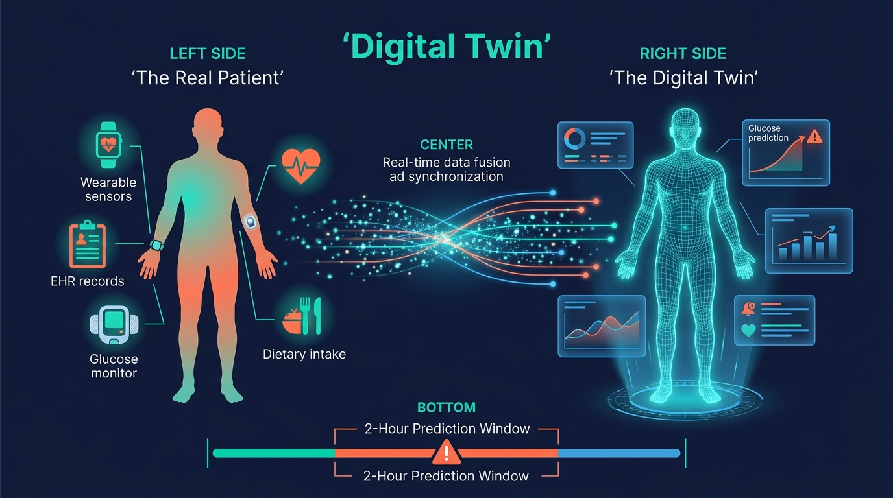
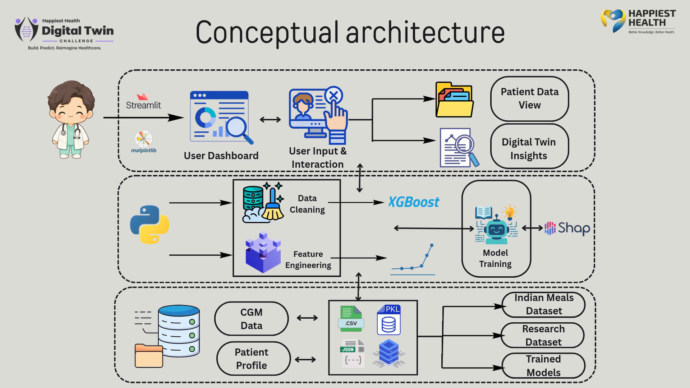
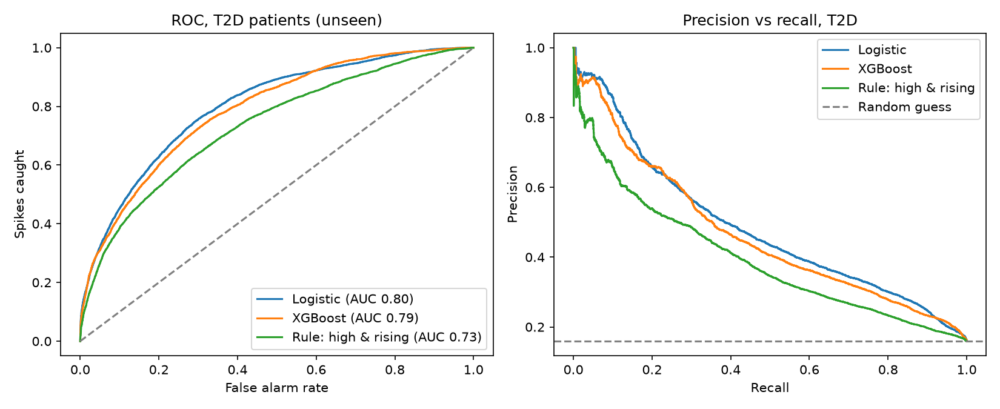
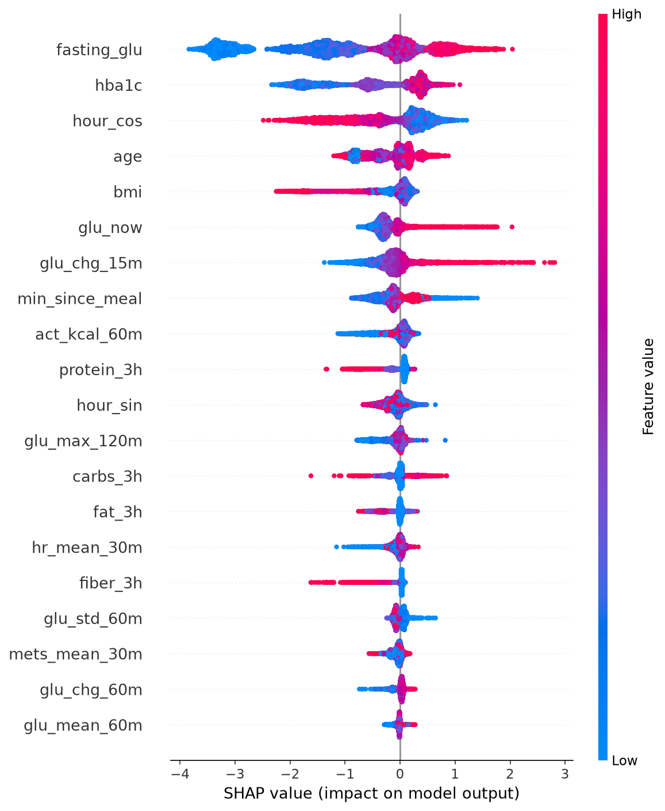
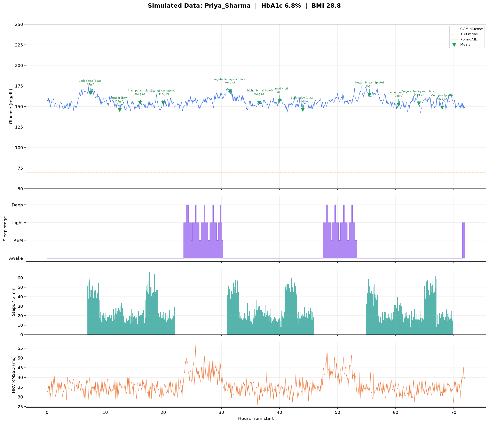

<div align="center">


# 🧬 GlucoTwin — Type 2 Diabetes Digital Twin

### *2-Hour Glucose Spike Prediction • Virtual Patient Simulator • Counterfactual Scenario Sandbox*

[](https://python.org)
[](https://streamlit.io)
[](https://xgboost.readthedocs.io)
[](https://scikit-learn.org)
[](LICENSE)

---

**A proof-of-concept Digital Twin model that fuses Electronic Health Records (EHR) with continuous wearable sensor data to predict dangerous glucose spikes 2 hours before they happen — enabling proactive, personalized Type 2 Diabetes management.**

*Built for the [Happiest Health — Reimagining and Reforming Healthcare in India Summit 2026](https://happiesthealthsummit.com), Bengaluru*

[🚀 Quick Start](#-quick-start) · [📊 Results](#-results) · [🏗️ Architecture](#%EF%B8%8F-system-architecture) · [🎥 Demo Video](#-demonstration-video) · [📄 Presentation](#-presentation)

</div>

---

## 📋 Table of Contents

- [👥 Team & Institution](#-team--institution)
- [🎯 Problem Statement](#-problem-statement--healthcare-use-case)
- [💡 What This Project Does](#-what-this-project-does)
- [🧩 Digital Twin Concept](#-the-digital-twin-concept)
- [🏗️ System Architecture](#%EF%B8%8F-system-architecture)
- [✅ Challenge Requirements Mapping](#-challenge-requirements-mapping)
- [📊 Results](#-results)
- [🔬 Models & Methods](#-models--methods)
- [📦 Data Sources & Provenance](#-data-sources--provenance)
- [🚀 Quick Start](#-quick-start)
- [🗂️ Repository Structure](#%EF%B8%8F-repository-structure)
- [🧪 Testing](#-testing)
- [⚠️ Honesty & Clinical Limitations](#%EF%B8%8F-honesty--clinical-limitations)
- [📄 Presentation](#-presentation)
- [🎥 Demonstration Video](#-demonstration-video)
- [📜 License](#-license)
- [🙏 Acknowledgements & References](#-acknowledgements--references)
- [⚕️ Medical Disclaimer](#%EF%B8%8F-medical-disclaimer)

---

## 👥 Team & Institution

<div align="center">

| | Detail |
|:---|:---|
| 🏷️ **Team Name** | **strawhats** |
| 🏫 **College / Incubator** | Army Institute of Technology, Pune |
| 👑 **Team Leader** | Adarsh Singh Bhadauriya |
| 👨‍💻 **Team Members** | Prabhat Ranjan · Pawan Singh Kunwar · Sumit Kumar |
| 📧 **Contact Email** | adarshaingh7080@gmail.com |

</div>

---

## 🎯 Problem Statement & Healthcare Use Case

<table>
<tr>
<td width="60%">

### The Challenge: Silent Glucose Spikes

Type 2 Diabetes (T2D) is one of India's most pressing health crises. **Postprandial glucose excursions exceeding 180 mg/dL** — critical markers of glycemic variability and vascular stress — frequently go undetected between routine clinic visits.

**Why existing methods fail:**
- 🔬 **HbA1c** captures 3-month averages, missing acute daily spikes
- 🩸 **Fasting glucose** provides a single morning snapshot
- ⏰ **No advance warning** exists for acute postprandial surges

### Our Solution: A 2-Hour Forward Warning

A reliable **2-hour prediction window** provides actionable lead time:
- 🚶 Allows **post-meal brisk walking** to attenuate the spike
- 🍽️ Enables **portion modification** before peak glucose hits
- 👨‍⚕️ Empowers clinicians with **proactive intervention** capabilities

</td>
<td width="40%">

> **India's Diabetes Burden**
>
> With one of the world's highest diabetes prevalence rates, India faces a unique challenge compounded by traditional carbohydrate-dense dietary patterns that produce acute glycemic spikes — making proactive glucose management not just valuable, but essential.

<br>

> [!IMPORTANT]
> This project predicts **new** glucose excursions (>180 mg/dL) within a 2-hour window **strictly when current glucose ≤ 180 mg/dL** — targeting early warning, not tracking existing hyperglycemia.

</td>
</tr>
</table>

---

## 💡 What This Project Does

<div align="center">

| Feature | Description |
|:---:|:---|
| 🎯 **Real-Data Spike Prediction** | Multimodal ML classifiers (Logistic Regression + XGBoost) trained on **45 human participants** from the CGMacros study, predicting glucose >180 mg/dL within 2 hours |
| 🧬 **Virtual Patient Simulator** | Generates continuous multi-day physiological streams: CGM glucose, sleep architecture, pedometer steps, heart rate, HRV, lab panels, medications, and polygenic risk scores |
| 👤 **Custom Patient Builder** | Six pre-configured clinical personas + a custom builder for creating tailored virtual patients with full parameter validation |
| 🧪 **Counterfactual Sandbox** | "What-if" scenario engine: compare baseline trajectories against sleep debt, Indian meal challenges, and brisk walking interventions |
| 🖥️ **Clinical Dashboard** | Streamlit workspace with 5 navigation modules: Patients Directory, Patient View, Real Reference Patients, Scenario Sandbox, and Assumptions Viewer |
| 🏷️ **Provenance Badges** | Enforced visual tagging (`REAL`, `SIMULATED`, `USER-ENTERED`, `NOT AVAILABLE`) — synthetic data is **never** presented as clinical measurement |

</div>

---

## 🧩 The Digital Twin Concept

<div align="center">



*A Digital Twin fuses real patient data (EHR + wearables) into a virtual replica that can simulate, predict, and test interventions before they reach the patient.*

</div>

### How Our Digital Twin Works

```
┌─────────────────────┐      ┌──────────────────────┐
│   📋 STATIC DATA     │      │   📱 DYNAMIC DATA     │
│   (EHR Stream)       │      │   (Wearable Stream)   │
│                      │      │                       │
│  • Demographics      │      │  • CGM Glucose (5min) │
│  • Past Diagnoses    │      │  • Heart Rate         │
│  • Lab Results       │      │  • Sleep Stages       │
│  • HbA1c, FPG        │      │  • Step Count         │
│  • Genetic Markers   │      │  • HRV (RMSSD)        │
│  • Medications       │      │  • Activity Calories   │
└──────────┬──────────┘      └───────────┬───────────┘
           │                              │
           └──────────┐  ┌────────────────┘
                      ▼  ▼
            ┌──────────────────┐
            │  🔀 FUSION ENGINE │
            │  22 Multimodal    │
            │  Features + 5     │
            │  Twin Extensions  │
            └────────┬─────────┘
                     ▼
          ┌────────────────────┐
          │  🤖 ML PREDICTION   │
          │  XGBoost / Logistic │
          │                     │
          │  "Will glucose      │
          │   spike >180 mg/dL  │
          │   in next 2 hours?" │
          └────────┬───────────┘
                   ▼
        ┌─────────────────────┐
        │  🚨 ALERT TIER       │
        │                      │
        │  LOW   < 0.75        │
        │  WATCH  0.75 – 0.91  │
        │  HIGH  ≥ 0.91        │
        └──────────────────────┘
```

---

## 🏗️ System Architecture

The project consists of two **parallel, decoupled pipelines** that share model inference and evaluation interfaces:

<div align="center">



The project presentation slide deck is available at [`docs/architecture.pdf`](docs/architecture.pdf).

</div>

### Pipeline Breakdown

<table>
<tr>
<td width="50%">

#### 🔬 Empirical Track (Real Data)

1. **Ingest** — CGMacros clinical data from PhysioNet (45 participants: 15 Healthy, 16 Prediabetes, 14 T2D)
2. **Parse** — 1-minute FreeStyle Libre CGM, optical HR, activity, meal logs
3. **Resample** — Align to 5-minute epochs
4. **Featurize** — 22 multimodal features (glucose dynamics, wearable vitals, nutritional accumulation, circadian rhythms, static EHR)
5. **Train** — Logistic Regression & XGBoost with 5-fold GroupKFold by participant
6. **Evaluate** — Bootstrap CI across T2D participants

</td>
<td width="50%">

#### 🧬 Digital Twin Track (Simulation)

1. **Create** — 6 clinical presets or custom virtual patients
2. **Simulate** — Multi-day physiological streams (CGM, sleep, steps, HR, HRV)
3. **Featurize** — Identical 22 features + 5 twin extensions (sleep quality, genetic risk, etc.)
4. **Score** — Real-trained models evaluate virtual patient spike risk
5. **Sandbox** — Counterfactual "what-if" interventions (sleep debt, Indian meals, walking)
6. **Transfer** — Sim-to-real domain transfer validation (ROC-AUC 0.768 on real T2D)

</td>
</tr>
</table>

---

## ✅ Challenge Requirements Mapping

Every requirement from the Happiest Health Digital Twin challenge brief is addressed:

| Brief Requirement | Implementation | Location |
|:---|:---|:---|
| **Static EHR Stream** | Age, gender, BMI, HbA1c, fasting glucose, diagnoses, medications, lab panels, polygenic risk | `src/load_cgmacros.py`, `src/sim/profile.py` |
| **Dynamic Wearable Stream** | 5-min CGM glucose, heart rate, activity calories, METs, sleep stages, steps, HRV | `src/features.py`, `src/sim/simulator.py` |
| **Data Fusion Model** | Multimodal fusion aligning sensor lags, rolling windows, nutritional accumulation, and static patient features | `src/features.py`, `src/ablation_fusion.py` |
| **Adverse Event Prediction** | Binary classification: glucose >180 mg/dL within 2h (ROC-AUC **0.800**) | `src/train.py`, `src/evaluate.py` |
| **Conceptual Doctor UI** | Streamlit workspace: patient directory, telemetry cards, risk tiers, SHAP explanations, scenario sandbox | `app/sim_workspace.py` |
| **Data Privacy Compliance** | Zero private patient data; anonymized public datasets + strictly labeled synthetics | `docs/DATA_LICENSES.md` |
| **Open-Source License** | MIT License for all repository source code | `LICENSE` |
| **Architecture Diagram** | System architecture visual + detailed text flow diagram | `docs/architecture.jpg` |
| **Presentation Deck** | Project details and outcomes slide deck | `docs/presentation.pdf` |
| **20-Minute Demo Video** | Recorded walkthrough of the complete prototype | [See Demo Video](#-demonstration-video) |

---

## 📊 Results

> [!NOTE]
> Real clinical data results and simulated data results are reported in **strictly separate tables**. Simulated metrics reflect digital twin pipeline demonstration, not clinical real-world performance.

### Table A: Real Clinical Data Results

*CGMacros, 45 Participants, Validated by Person (Held-out T2D: N=14, 128,006 epochs, spike rate = 15.9%)*

<div align="center">

| Model | ROC-AUC (95% CI) | PR-AUC | vs. Heuristic Baseline |
|:---|:---:|:---:|:---|
| **🥇 Logistic Regression** | **0.800** (0.766–0.838) | **0.484** | +0.031 to +0.111 improvement |
| **🥈 XGBoost Classifier** | **0.787** (0.744–0.830) | **0.465** | Statistically tied; used for SHAP |
| 📏 Simple Heuristic Rule | 0.733 (0.701–0.756) | n/a | Baseline: `glu_now + 2×glu_chg_30m` |

</div>

<div align="center">


*ROC and Precision-Recall curves for held-out T2D participants. Both ML models significantly outperform the simple heuristic baseline.*

</div>

#### Key Findings

- **Per-Person AUC**: Median **0.82** across T2D participants; lowest individual: **0.66** (all above chance)
- **Meal Response Model (Random Forest)**: MAE = **31.5 mg/dL**, R² = **+0.30** on unseen T2D participants
- **Ridge coefficients**: Carbs **+0.37 mg/dL per gram**, Dietary fiber **−0.65 mg/dL per gram**

### Table B: Simulator Fidelity vs Real Data

*Benchmarking 1,800 simulated patient-days against real FreeStyle Libre CGMacros IQR targets*

<div align="center">


*Virtual Patient Simulator fidelity comparison against real CGMacros clinical data across all three glycemic groups.*

</div>

<details>
<summary>📋 Click to expand detailed fidelity tables</summary>

#### Healthy Group (HbA1c < 5.7%)

| Statistic | Real (Median) | Real IQR | Simulated | Status |
|:---|:---:|:---:|:---:|:---:|
| 24h Mean Glucose | 84.54 | [77.75–89.84] | 87.50 | ✅ PASS |
| Time >140 mg/dL | 2.75% | [0.00–2.45%] | 1.52% | ✅ PASS |
| Time >180 mg/dL | 0.68% | [0.00–0.00%] | 0.03% | ✅ PASS |
| 2h Post-Meal Rise | 32.50 | [25.10–36.21] | 29.08 | ✅ PASS |
| Overnight Mean | 75.19 | [67.67–86.43] | 80.41 | ✅ PASS |
| Mean Heart Rate | 77.91 | [73.00–83.00] | 76.45 | ✅ PASS |

#### Prediabetes Group (5.7% ≤ HbA1c ≤ 6.4%)

| Statistic | Real (Median) | Real IQR | Simulated | Status |
|:---|:---:|:---:|:---:|:---:|
| 24h Mean Glucose | 107.15 | [93.52–116.10] | 113.23 | ✅ PASS |
| Time >140 mg/dL | 12.23% | [2.66–18.42%] | 11.75% | ✅ PASS |
| Time >180 mg/dL | 2.72% | [0.16–3.24%] | 1.96% | ✅ PASS |
| 2h Post-Meal Rise | 44.83 | [34.10–55.30] | 38.35 | ✅ PASS |
| Overnight Mean | 98.98 | [89.20–111.01] | 103.60 | ✅ PASS |
| Mean Heart Rate | 79.12 | [74.00–84.00] | 76.29 | ✅ PASS |

#### Type 2 Diabetes Group (HbA1c ≥ 6.5%)

| Statistic | Real (Median) | Real IQR | Simulated | Status |
|:---|:---:|:---:|:---:|:---:|
| 24h Mean Glucose | 136.72 | [112.32–155.42] | 138.00 | ✅ PASS |
| Time >140 mg/dL | 36.97% | [13.94–55.81%] | 42.75% | ✅ PASS |
| Time >180 mg/dL | 16.02% | [4.24–25.45%] | 8.76% | ✅ PASS |
| 2h Post-Meal Rise | 62.81 | [50.50–71.61] | 48.36 | ⚠️ Below IQR |
| Overnight Mean | 120.10 | [100.99–134.23] | 125.81 | ✅ PASS |
| Mean Heart Rate | 79.43 | [74.00–85.00] | 77.78 | ✅ PASS |

</details>

### Table C: Sim-to-Real Domain Transfer

*Trained exclusively on 300 simulated virtual patients → evaluated on real CGMacros participants*

| Track | Training | Evaluation | ROC-AUC | PR-AUC | Recall |
|:---|:---|:---|:---:|:---:|:---:|
| **Sim → Real (All)** | 300 virtual patients | 45 real participants | **0.859** | 0.344 | 0.644 |
| **Sim → Real (T2D)** | 300 virtual patients | 14 T2D participants | **0.768** | 0.411 | 0.784 |
| **Real → Sim** | 45 real participants | 300 virtual patients | **0.901** | 0.546 | 0.543 |

### Model Interpretability (SHAP)

<div align="center">


*SHAP summary plot: Feature attributions for the XGBoost spike classifier. Fasting glucose, HbA1c, circadian timing, and current glucose level dominate predictions.*

</div>

### Virtual Patient Simulation Example

<div align="center">


*Multi-day simulated patient (Priya_Sharma, HbA1c 6.8%, BMI 28.8): CGM glucose with Indian meal annotations, sleep architecture, step count, and HRV telemetry.*

</div>

---

## 🔬 Models & Methods

### Feature Engineering Pipeline

The prediction pipeline computes **22 multimodal features** at each 5-minute time step:

<table>
<tr>
<td width="50%">

**📈 Glucose Dynamics (7 features)**
- Current glucose (`glu_now`)
- Rate of change: 15m, 30m, 60m
- Rolling mean & std (60m)
- Trailing maximum (120m)

**💓 Wearable Vitals (3 features)**
- Heart rate (30m mean)
- Activity calories (60m cumulative)
- METs (30m mean)

**🍽️ Nutritional Accumulation (5 features)**
- Carbs, protein, fat, fiber (3h trailing)
- Minutes since last meal

</td>
<td width="50%">

**🕐 Circadian Rhythms (2 features)**
- Sinusoidal hour encodings (`sin`, `cos`)

**🏥 Static EHR Profile (5 features)**
- Age, sex, BMI, HbA1c, fasting glucose

**🧬 Digital Twin Extensions (5 features)**
- Sleep duration & deep sleep %
- Steps (60m), nocturnal HRV
- Polygenic risk score

</td>
</tr>
</table>

### Validation Strategy

- **5-Fold GroupKFold** by participant — no data leakage between train/val
- **Bootstrap CI** resampled across T2D participants (not time-series rows)
- **Alert tiers** calibrated against class-weighted probability distributions:
  - `LOW` (score < 0.75) · `WATCH` (0.75–0.91, ~52% recall, ~40% precision) · `HIGH` (≥ 0.91, ~27% recall, ~60% precision)

### Meal Response Model

Dedicated postprandial model trained on **1,246 isolated meals** (388 from T2D participants):
- **Random Forest**: MAE = 31.5 mg/dL, R² = +0.30
- **Ridge Regression**: MAE = 34.5 mg/dL, R² = +0.19
- Features: macronutrients, starting glucose, time of day, BMI, HbA1c

---

## 📦 Data Sources & Provenance

| Source | Type | Description | License |
|:---|:---:|:---|:---|
| **CGMacros** | `REAL` | Free-living CGM + wearable data from 45 participants via PhysioNet | CC BY-NC-SA 4.0 |
| **Indian Nutrient Databank** | `USER-ENTERED` | 17 Indian dishes with macronutrients (Vijayakumar et al., 2024) | Academic |
| **Virtual Patient Simulator** | `SIMULATED` | In-repo physiological engine (`src/sim/`) | MIT |
| **Virtual Patient Presets** | `SIMULATED` | 6 clinical personas with deterministic seeds | MIT |
| **Prototype Generator** | `SIMULATED` | 150 toy synthetic patients for scaffolding | MIT |

> [!IMPORTANT]
> **No raw CGMacros data is committed to this repository.** Raw clinical data is excluded via `.gitignore`. To obtain it, download from PhysioNet and place into `data/raw/cgmacros/`.

---

## 🚀 Quick Start

### Prerequisites

- **Python 3.12** (recommended via `uv` or `venv`)
- **OS**: Linux / macOS / WSL

### 1️⃣ Clone the Repository

```bash
git clone https://github.com/delulu-monkey/strawhats_AITPune.git
cd strawhats_AITPune
```

### 2️⃣ Set Up Environment

```bash
python3.12 -m venv .venv
source .venv/bin/activate
pip install --upgrade pip
pip install -r requirements.txt
```

### 3️⃣ Launch the Digital Twin Workspace (Instant — No External Data Required)

```bash
streamlit run app/sim_workspace.py
```

The simulation workspace is **fully functional out of the box** using pre-calibrated virtual patients:

| Module | Description |
|:---|:---|
| 👥 **Patients Directory** | Browse presets, search, or create custom virtual patients |
| 👤 **Patient View** | Inspect 7-day multi-sensor telemetry, labs, sleep, and spike risk |
| 🧪 **Scenario Sandbox** | Test sleep deprivation, Indian meals, and walking interventions |
| ⚙️ **Assumptions** | Review all physiological constants and mathematical rationales |

### 4️⃣ Run Tests

```bash
pytest tests/
```

> 48 of 49 tests pass immediately on fresh clone. The single remaining test (`test_real_reference_patients_not_available_fields`) requires the CGMacros `bio.csv` file.

### 5️⃣ Full Pipeline (Requires External Data)

<details>
<summary>📋 Click to expand full pipeline instructions</summary>

**Download data:**
1. **CGMacros**: [PhysioNet](https://www.physionet.org/content/cgmacros/1.0.0/) → place into `data/raw/cgmacros/`
2. **INDB**: Download `INDB.xlsx` → place into `data/raw/indb/`

**Run the pipeline:**

```bash
# 1. Parse raw CGMacros into 1-minute time series
python src/load_cgmacros.py

# 2. Extract 5-minute multimodal feature matrix
python src/features.py

# 3. Extract 17 Indian dishes from INDB
python src/indian_meals.py

# 4. Train 2-hour spike classifiers (Logistic + XGBoost)
python src/train.py

# 5. Train postprandial meal-response models (RF + Ridge)
python src/train_meal.py

# 6. Evaluate held-out T2D performance with bootstrap intervals
python src/evaluate.py

# 7. Generate 300-patient simulated cohort + calibrate + train twin
python src/sim/cohort.py
python src/sim/calibrate.py
python src/sim/train_twin.py

# 8. Launch the real-data clinical dashboard
streamlit run app/dashboard.py
```

</details>

---

## 🗂️ Repository Structure

```text
strawhats_AITPune/
├── 📂 app/
│   ├── sim_workspace.py                  # Main Digital Twin Workspace (Streamlit)
│   ├── dashboard.py                      # Real-data clinical dashboard
│   └── 📂 sim_ui/                        # Modular UI components
│       ├── assumptions_view.py           #   Physiological constants viewer
│       ├── badges.py                     #   Provenance badges (REAL/SIMULATED/etc.)
│       ├── common.py                     #   Shared loaders, caching, parsers
│       ├── patient_view.py               #   Virtual patient telemetry view
│       ├── patients_list.py              #   Patient directory + custom builder
│       ├── real_patients.py              #   Real CGMacros participant inspector
│       ├── scenario_sandbox.py           #   What-if intervention sandbox
│       ├── style.css                     #   Custom styling
│       ├── theme.py                      #   High-contrast UI theme + SVG renderers
│       └── twin_figure.py               #   Multi-signal telemetry visualization
│
├── 📂 data/
│   ├── indian_meals.csv                  # 17 Indian dishes (INDB extract)
│   ├── 📂 processed/                     # Processed time-series tables
│   ├── 📂 raw/                           # Synthetic baseline tables
│   └── 📂 virtual_patients/presets/      # 6 clinical preset personas (JSON)
│
├── 📂 docs/
│   ├── hero_banner.jpg                   # Project hero banner
│   ├── architecture.jpg                  # System architecture diagram
│   ├── digital_twin_concept.jpg          # Digital twin concept visualization
│   ├── sim_fidelity.png                  # Calibration comparison chart
│   └── 📂 results/                       # Evaluation reports & figures
│       ├── roc_pr_t2d.png                #   ROC/PR curves
│       ├── shap_xgboost.png              #   SHAP summary plot
│       ├── sim_example_patient.png       #   Simulated patient telemetry
│       ├── auc_per_person.png            #   Per-person AUC scatter
│       ├── logistic_weights.png          #   Feature weights
│       └── twin_model_report.md          #   Sim-to-real transfer report
│
├── 📂 models/
│   ├── logistic_spike_model.pkl          # Logistic Regression spike classifier
│   ├── xgb_spike_model.pkl              # XGBoost spike classifier
│   ├── meal_response_rf.pkl             # Random Forest meal model
│   ├── meal_response_ridge.pkl          # Ridge meal model
│   └── twin_model.pkl                   # XGBoost trained on 300 virtual patients
│
├── 📂 src/
│   ├── features.py                       # 5-min multimodal feature extraction
│   ├── train.py                          # Spike classifier training
│   ├── train_meal.py                     # Meal-response model training
│   ├── evaluate.py                       # Evaluation + bootstrap intervals
│   ├── explain.py                        # SHAP attribution generator
│   ├── load_cgmacros.py                  # CGMacros ingestion pipeline
│   ├── indian_meals.py                   # INDB dish parser
│   ├── ablation_fusion.py                # Wearable vs EHR ablation study
│   ├── generate_data.py                  # Prototype synthetic data generator
│   └── 📂 sim/                           # Physiological simulator package
│       ├── simulator.py                  #   Multi-day simulation engine
│       ├── profile.py                    #   VirtualPatient dataclass
│       ├── featurize.py                  #   Twin featurizer (22+5 features)
│       ├── scenarios.py                  #   Counterfactual what-if engine
│       ├── assumptions.py                #   Central physiological constants
│       ├── calibrate.py                  #   Calibration vs CGMacros IQR
│       ├── cohort.py                     #   300-patient cohort generator
│       ├── store.py                      #   JSON persistence + provenance
│       └── train_twin.py                #   Digital twin model training
│
├── 📂 tests/                             # 49 automated tests (pytest)
├── LICENSE                               # MIT License
├── requirements.txt                      # Frozen Python dependencies
└── README.md                             # This file
```

---

## 🧪 Testing

The project includes a comprehensive test suite with **49 automated tests**:

```bash
pytest tests/ -v
```

| Test Module | Coverage |
|:---|:---|
| `test_simulator.py` | Determinism, physiological ranges, multi-day consistency |
| `test_scenarios.py` | Counterfactual interventions (sleep, meals, walking) |
| `test_featurize.py` | Feature schema parity between real and simulated data |
| `test_store.py` | Patient storage CRUD, read-only protection |
| `test_consistency.py` | Independent calculations, lipid consistency |
| `test_calibration.py` | Calibration target extraction |
| `test_workspace.py` | End-to-end Streamlit AppTest integration |
| `test_theme.py` | UI theme rendering, SVG generators |
| `test_twin.py` | Cohort generation, twin model inference |

---

## ⚠️ Honesty & Clinical Limitations

### What Worked

✅ ML models beat heuristic baselines by meaningful margins (ROC-AUC 0.80 vs 0.73)  
✅ Simulator fidelity matches real CGMacros IQR on most metrics  
✅ Sim-trained model transfers to real data (ROC-AUC 0.768 on T2D)  
✅ SHAP explanations provide clinically interpretable feature attributions  

### What Did Not Work (Honest Negative Results)

| Finding | Detail |
|:---|:---|
| ⚠️ **Wearable benefit unclear** | Adding HR + activity raised AUC from 0.770→0.787, but 95% CI includes zero (−0.004 to +0.035) |
| ⚠️ **Static EHR alone near chance** | Within T2D cohort, demographics alone can't predict immediate spikes |
| ❌ **Activity what-if removed** | Model learned observational association (activity ↔ eating) instead of causal mitigation — removed from UI |
| ⚠️ **Meal what-if is directional only** | 100g carb increase = ~20 mg/dL rise, but prediction error is ~31.5 mg/dL MAE |
| ⚠️ **No sleep ground truth** | Simulated sleep stages are entirely synthetic and unvalidated |
| ⚠️ **Preset outliers** | Some presets (HbA1c 8.8%) exceed the real study cohort range (max 8.5%) |

### Clinical Transparency

- 🔬 **Simulated values are assumptions**, not measurements — all documented in `src/sim/assumptions.py`
- 🎓 **Not a medical device** — this is a student hackathon research prototype
- 📋 **Boundary condition**: Model applies strictly when current glucose ≤ 180 mg/dL

---

## 🛠️ Technical Stack

<div align="center">

| Category | Technologies |
|:---:|:---|
| **Language** | Python 3.12 |
| **ML / AI** | XGBoost 3.4 · scikit-learn 1.9 · SHAP 0.52 |
| **Data Processing** | pandas 3.0 · NumPy 2.5 · SciPy 1.18 |
| **Visualization** | Matplotlib 3.11 · Streamlit 1.65 · Altair 6.3 |
| **UI Framework** | Streamlit (clinical dashboard + simulation workspace) |
| **Testing** | pytest 9.1 (49 automated tests) |
| **Simulation** | Custom physiological engine (AR(1) CGM, 90-min sleep cycles) |

</div>

---

## 📄 Presentation

The project presentation slide deck is available at [`docs/presentation.pdf`](docs/presentation.pdf).

> Contains: Project overview, problem statement, architecture, technical approach, results, clinical implications, and future roadmap.

---

## 🎥 Demonstration Video

<!-- TODO: Replace with actual unlisted YouTube URL -->

> 📹 A comprehensive **20+ minute video walkthrough** demonstrating the complete Digital Twin prototype is available here:
>
> 🔗 **https://youtu.be/_Ti40Y72qL8(#)** *(Unlisted)*
>
> The video covers: system architecture, data pipeline, model training, virtual patient creation, scenario sandbox, SHAP explanations, and clinical dashboard walkthrough.

---

## 📜 License

This project is licensed under the **MIT License** — see the [`LICENSE`](LICENSE) file for details.

**Third-party data licenses:**
- **CGMacros Dataset**: CC BY-NC-SA 4.0 (PhysioNet)
- **Indian Nutrient Databank**: Academic use (Vijayakumar et al., 2024)

---

## 🙏 Acknowledgements & References

<table>
<tr>
<td>

### Datasets

1. **CGMacros Dataset** — Hall H, et al. *CGMacros Continuous Glucose Monitoring and Macronutrient Study.* PhysioNet.
2. **Indian Nutrient Databank (INDB)** — Vijayakumar A, Dubasi HB, Awasthi A, Jaacks LM. *Development of an Indian Food Composition Database.* Current Developments in Nutrition, 2024;8(9):104443.

</td>
<td>

### Core Libraries

3. **XGBoost** — Chen T, Guestrin C. *KDD*, 2016.
4. **SHAP** — Lundberg SM, Lee SI. *NeurIPS*, 2017.
5. **scikit-learn** — Pedregosa F, et al. *JMLR*, 2011.
6. **Streamlit** — Open-source app framework (Apache 2.0).
7. **pandas / NumPy / Matplotlib** — Python scientific computing ecosystem.

</td>
</tr>
</table>

### Hackathon

This project was built for the **Happiest Health — Reimagining and Reforming Healthcare in India Summit 2026**, Bengaluru, as part of the Digital Twin Healthcare Challenge.

---

## ⚕️ Medical Disclaimer

> [!CAUTION]
> ### ⚠️ RESEARCH PROTOTYPE — NOT A MEDICAL DEVICE
>
> This software is an **experimental digital twin prototype** developed for a student hackathon challenge. All virtual patient trajectories, counterfactual scenarios, and spike alerts are generated via mathematical models and assumptions or derived from anonymized research datasets.
>
> **This repository does NOT provide:**
> - Clinical diagnosis
> - Medical treatment recommendations
> - Therapeutic decision support
>
> **It must NOT be used as a substitute for professional clinical judgement.**

---

<div align="center">

*Built with ❤️ by Team Strawhats — Army Institute of Technology, Pune*

**Happiest Health — Reimagining and Reforming Healthcare in India Summit 2026**


</div>
